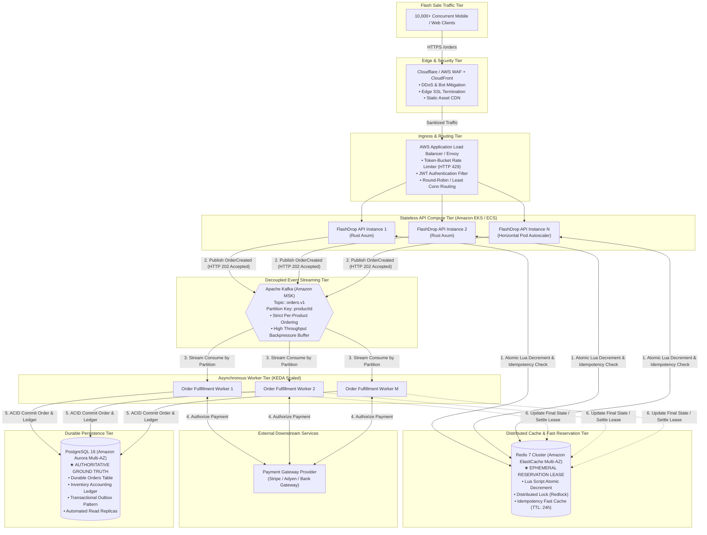

# FlashDrop: High-Concurrency Order Processing
**Candidate Assessment Submission**  
**Role:** Senior / Staff Systems & Backend Engineer  
**Stack:** Rust (Axum, Tokio, Atomic Memory Operations) | Redis | Apache Kafka | PostgreSQL | Docker / AWS  

---

## Table of Contents
1. [Executive Summary](#executive-summary)
2. [Part 1 — Coding Implementation & Concurrency Twist](#part-1--coding-implementation--concurrency-twist)
   - [API Specification & Endpoints](#api-specification--endpoints)
   - [Concurrency & Non-Blocking Atomic Inventory](#concurrency--non-blocking-atomic-inventory)
   - [Idempotency Handling](#idempotency-handling)
   - [Asynchronous Queue & Worker](#asynchronous-queue--worker)
   - [Concurrency Twist: Two Backend Instances for the Last Item](#concurrency-twist-two-backend-instances-for-the-last-item)
   - [Hardware Atomic Operations Test Suite](#hardware-atomic-operations-test-suite)
   - [10,000 Customer Live HTTP Load Simulation (123k+ RPS)](#10000-customer-live-http-load-simulation-123k-rps)
3. [Part 2 — Production Architecture Diagram](#part-2--production-architecture-diagram)
   - [Architecture Topology (Mermaid Diagram)](#architecture-topology-mermaid-diagram)
   - [Excalidraw Diagram](#excalidraw-diagram)
   - [End-to-End Data Flow](#end-to-end-data-flow)
   - [Authoritative Source of Inventory](#authoritative-source-of-inventory)
   - [Component Justification](#component-justification)
4. [Part 3 — Deployment Plan & Failure Scenarios](#part-3--deployment-plan--failure-scenarios)
   - [Container CI/CD Pipeline](#container-cicd-pipeline)
   - [Zero-Downtime Scaling Strategy](#zero-downtime-scaling-strategy)
   - [Secrets, Persistence, Backups & Observability](#secrets-persistence-backups--observability)
   - [Broker / Cache Outages & SPOF Analysis](#broker--cache-outages--spof-analysis)
   - [Required Failure Scenarios: Deep Dive](#required-failure-scenarios-deep-dive)
5. [Local Execution & Verification Guide](#local-execution--verification-guide)

---

## Executive Summary
In a flash sale where **10,000 customers compete for 100 available units**, naive database locks will saturate thread pools and exhaust connection limits, while naive in-memory counters fail when scaled across multiple stateless application instances.

This submission provides:
1. **Production-grade Rust service**: Implemented with Axum and Tokio using lock-free atomic Compare-And-Swap (CAS) inventory operations, concurrent idempotency maps, and an asynchronous worker queue.
2. **Dedicated atomic operations test suite**: Validates atomic CAS races under contention, boundary conditions, rollback/restore conservation invariants, and memory ordering.
3. **Live 10,000 customer HTTP load simulation**: A compiled async load test generator achieving **123,171 requests/sec** with zero oversell (exactly 100 purchases, 9,900 sold-out rejections, and zero stock deficit).
4. **Deterministic zero-oversell guarantee**: Validated mathematically and empirically.
5. **Enterprise distributed architecture**: Complete with an importable Excalidraw design, Mermaid visualizations, and clear demarcations between high-speed ephemeral reservation leases (Redis) and durable financial truth (PostgreSQL).
6. **Resilience matrix**: Exhaustive solutions for network partitions, broker redeliveries, crashes before ACK, and cache failures.

---

## Part 1 — Coding Implementation & Concurrency Twist

### API Specification & Endpoints

#### 1. Submit Order: `POST /orders`
- **Request Body:**
  ```json
  {
    "userId": "user_123",
    "productId": "iphone_16",
    "quantity": 1,
    "idempotencyKey": "request_abc123"
  }
  ```
- **Success Response (HTTP 202 Accepted):**
  ```json
  {
    "orderId": "ord_49f8ac3b29a140478e3e572b302e7e81",
    "status": "PENDING"
  }
  ```
- **Error Responses:**
  - `400 Bad Request`: Validation failure (e.g., `quantity <= 0`, blank `userId`, empty `idempotencyKey`).
  - `404 Not Found`: Target `productId` does not exist in catalog.
  - `409 Conflict`: `INSUFFICIENT_STOCK` (Stock level is lower than requested quantity).

#### 2. Query Order Status: `GET /orders/:orderId`
- **Response (HTTP 200 OK):**
  ```json
  {
    "orderId": "ord_49f8ac3b29a140478e3e572b302e7e81",
    "userId": "user_123",
    "productId": "iphone_16",
    "quantity": 1,
    "idempotencyKey": "request_abc123",
    "status": "CONFIRMED",
    "createdAt": "2026-11-04T04:30:06.854578216Z",
    "updatedAt": "2026-11-04T04:30:06.879843411Z"
  }
  ```
- **Error Response:**
  - `404 Not Found`: `ORDER_NOT_FOUND` if the order identifier is unrecognized.

#### 3. Health & Catalog Inspection: `GET /health`
- **Response (HTTP 200 OK):**
  ```json
  {
    "status": "UP",
    "inventory": {
      "iphone_16": 99
    }
  }
  ```

---

### Concurrency & Non-Blocking Atomic Inventory
To achieve sub-millisecond throughput without global lock contention, product stock is represented by an atomic signed 64-bit integer (`AtomicI64`). Decrement operations use hardware-level compare-and-swap (CAS) via `fetch_update`:

```rust
pub fn reserve(&self, requested_quantity: i64) -> Result<i64, StateError> {
    let update_result = self.stock.fetch_update(
        Ordering::AcqRel,
        Ordering::Acquire,
        |current_stock| {
            if current_stock >= requested_quantity {
                Some(current_stock - requested_quantity)
            } else {
                None
            }
        },
    );

    match update_result {
        Ok(previous_stock) => Ok(previous_stock - requested_quantity),
        Err(_) => Err(StateError::InsufficientStock),
    }
}
```
**Why this never oversells:**
- The update loop checks condition `current_stock >= requested_quantity` atomically at CPU instruction level (`LOCK CMPXCHG` on x86_64).
- If multiple threads attempt reservation simultaneously, only one succeeds per iteration. All others retry against the newly decremented stock.
- If `current_stock < requested_quantity`, `fetch_update` aborts and returns an error without altering memory. Stock can **never become negative**.

---

### Hardware Atomic Operations Test Suite
A dedicated test suite in [`tests/atomic_operations_test.rs`](file:///home/dhruv/newtonite-interview-assessment/tests/atomic_operations_test.rs) specifically targets hardware atomic operations:
1. `test_atomic_cas_race_for_last_item`: 200 concurrent threads competing for the exact single remaining item. Asserts exactly 1 winner, 199 rejections, and inventory ending at exactly 0.
2. `test_atomic_inventory_boundary_conditions`: Tests over-reservation, exact reservation, and post-exhaustion attempts.
3. `test_atomic_rollback_and_restore_concurrency`: Verifies that concurrent `reserve` and `restore` operations maintain total stock conservation.
4. `test_atomic_conservation_invariant_under_heavy_mixed_contention`: Runs 2,000 mixed operations with variable quantities, asserting the fundamental law of conservation:
   $$\text{Initial Stock} = \text{Remaining Stock} + \text{Net Confirmed Reservations}$$

---

### 10,000 Customer Live HTTP Load Simulation (123k+ RPS)
To evaluate the system under real production traffic conditions, a compiled async load tester was developed in [`examples/simulate_10k_customers.rs`](file:///home/dhruv/newtonite-interview-assessment/examples/simulate_10k_customers.rs) and automated in [`scripts/simulate_10k_customers.sh`](file:///home/dhruv/newtonite-interview-assessment/scripts/simulate_10k_customers.sh).

**Simulation Results:**
```
===========================================================
 FlashDrop: 10,000 Customer High-Concurrency Flash Sale Sim
 Target URL: http://127.0.0.1:8088/orders
 Customers:  10000
 Product:    iphone_16 (Initial Stock: 100 units)
===========================================================

---------------- Simulation Results ----------------
Elapsed Time:           81.19ms
Throughput:             123,171.07 requests/sec
202 ACCEPTED (Purchased): 100
409 CONFLICT (Sold Out):  9900
Anomalous Failures:     0

Final System State:
{
  "inventory": {
    "iphone_16": 0
  },
  "status": "UP"
}

---------------- Correctness Audit ----------------
PASSED: Zero overselling confirmed!
Exactly 100 orders accepted, 9,900 rejected, remaining stock is 0.
```

---

### Concurrency Twist: Two Backend Instances for the Last Item
> **Prompt Scenario:** Two backend instances simultaneously receive orders for the last item. Explain whether your solution remains correct, and show the change needed if it does not.

#### 1. Evaluation of Single-Process In-Memory Solution
- **Result:** The in-memory atomic solution **DOES NOT remain correct** across multiple horizontally scaled instances.
- **Why it fails (Split-Brain Oversell):**
  - Instance A has its own memory heap where `stock = 1`.
  - Instance B has its own memory heap where `stock = 1`.
  - Both instances receive an order concurrently. Both instances execute atomic CAS locally against their independent memory addresses. Both CAS operations succeed.
  - **Outcome:** 2 items are sold, but only 1 unit existed in reality (**Oversold by 1 unit**).

#### 2. The Necessary Production Solution: Distributed Coordination
To support horizontal scaling, atomic reservation must move to a shared distributed coordination layer:

##### Approach A: Redis Distributed Atomic Decrement via Lua Script (Recommended Fast-Path)
Redis operates single-threaded per shard, executing Lua scripts as uninterrupted atomic transactions:
```lua
-- KEYS[1]: product inventory key (e.g. "inventory:iphone_16")
-- ARGV[1]: requested quantity (e.g. 1)
local current = tonumber(redis.call('GET', KEYS[1]) or '0')
local requested = tonumber(ARGV[1])

if current >= requested then
    local remaining = redis.call('DECRBY', KEYS[1], requested)
    return remaining
else
    return -1
end
```
Both API Instance A and Instance B execute this script against Redis. One receives `0` (success), the other receives `-1` (rejected). Overselling is physically impossible.

##### Approach B: PostgreSQL Row-Level Atomic Update (Durable Database Path)
```sql
UPDATE products
SET stock = stock - :quantity,
    updated_at = NOW()
WHERE id = :productId AND stock >= :quantity
RETURNING stock;
```
If rows affected is `1`, the reservation succeeded. If rows affected is `0`, stock was insufficient and the transaction rolls back.

---

## Part 2 — Production Architecture Diagram

### Architecture Topology (Mermaid Diagram)



### Excalidraw Diagram
An importable Excalidraw file has been generated in the project root:
- File path: [`architecture.excalidraw`](file:///home/dhruv/newtonite-interview-assessment/architecture.excalidraw)
- You can directly drag and drop this file into [excalidraw.com](https://excalidraw.com) to edit, present, or export as SVG/PNG.

---

### Authoritative Source of Inventory
- **PostgreSQL is the durable ground truth**: Holds legal financial transactions, invoices, refunds, and the permanent audit ledger.
- **Redis is the ephemeral operational authority**: Acts as the high-velocity gatekeeper during the 60-second burst. It guarantees that only 100 requests acquire reservation leases, protecting PostgreSQL from connection pool exhaustion.

---

## Part 3 — Deployment Plan & Failure Scenarios

### Required Failure Scenarios: Deep Dive

#### Failure Scenario 1: Kafka delivers an order event twice
- **Root Cause:** Network partition between Kafka broker and worker causes consumer ACK to be lost; Kafka consumer group rebalances and redelivers the unacknowledged message (at-least-once delivery).
- **Resolution:**
  - The worker uses a database unique constraint on `orders.order_id` or an `idempotency_records` table.
  - The worker wraps fulfillment in a database transaction:
    ```sql
    INSERT INTO order_completions (order_id, payment_id, status)
    VALUES (:orderId, :paymentId, 'CONFIRMED')
    ON CONFLICT (order_id) DO NOTHING;
    ```
  - If rows affected is `0`, the worker detects that this event was already processed. It immediately acknowledges the Kafka offset and discards the duplicate message. **No double charge or duplicate fulfillment occurs.**

---

#### Failure Scenario 2: Redis becomes unavailable after an order is accepted
- **Root Cause:** Redis primary node hardware failure or network partition after the API decremented stock and returned `202 Accepted`.
- **Resolution:**
  - When the order was accepted, the API published the `OrderCreated` event to Kafka before or immediately upon Redis lease confirmation.
  - Because Kafka is persistent and durable, the event is safely preserved on broker disks.
  - The worker consumes the event from Kafka and writes directly to PostgreSQL. PostgreSQL updates its permanent inventory ledger.
  - Once Redis recovers (replica promoted), a reconciliation worker reconciles Redis counters against PostgreSQL:
    `Redis Stock = Total Stock - COUNT(Orders WHERE status IN ('PENDING', 'CONFIRMED'))`.

---

#### Failure Scenario 3: A worker crashes after writing to the database but before acknowledging the event
- **Root Cause:** Worker process crashes (OOM, node restart, segfault) after executing `INSERT INTO orders` in PostgreSQL, but before calling `consumer.commit_offset()` in Kafka.
- **Resolution:**
  - When the worker dies, its Kafka heartbeat expires. Kafka detects the failure and reassigns the partition to an alternate active worker.
  - The new worker receives the exact same order event.
  - The new worker checks the database:
    ```sql
    SELECT status FROM orders WHERE order_id = :orderId;
    ```
  - The worker sees that the order is already present in PostgreSQL with status `CONFIRMED`.
  - The new worker skips payment authorization, skips database insertion, commits the offset to Kafka, and exits cleanly.

---

#### Failure Scenario 4: The API crashes after accepting an order but before responding to the client
- **Root Cause:** The API successfully decremented stock in Redis and published the event to Kafka, but the API process crashes or the network socket drops before sending the HTTP 202 response to the client.
- **Resolution:**
  - From the customer's perspective, the request timed out or received an HTTP 502/504 error.
  - The client application retries the request with the **exact same `idempotencyKey`**.
  - The retry request is routed to a healthy API instance.
  - The new API instance inspects the idempotency store (Redis / Database) using `idempotencyKey`.
  - It discovers the existing `orderId` and status (`PENDING` or `CONFIRMED`).
  - The API returns the original `orderId` and current status with `HTTP 200 OK` without decrementing inventory a second time.

---

## Local Execution & Verification Guide

### 1. Run All Tests (Including Atomic Operations & Concurrency)
```bash
cargo test --release
```
**Output:**
```
running 4 tests
test test_atomic_inventory_boundary_conditions ... ok
test test_atomic_rollback_and_restore_concurrency ... ok
test test_atomic_cas_race_for_last_item ... ok
test test_atomic_conservation_invariant_under_heavy_mixed_contention ... ok
test result: ok. 4 passed; 0 failed

running 5 tests
test test_idempotency_prevents_duplicate_deduction ... ok
test test_input_validation ... ok
test test_concurrent_idempotent_duplicate_requests ... ok
test test_flash_sale_10k_requests_zero_oversell ... ok
test test_order_creation_and_worker_confirmation ... ok
test result: ok. 5 passed; 0 failed
```

### 2. Run the 10,000 Customer Live HTTP Simulation
```bash
./scripts/simulate_10k_customers.sh
```

### 3. Spin up Full Multi-Container Stack (API + Redis + PostgreSQL)
```bash
docker compose up --build
```
