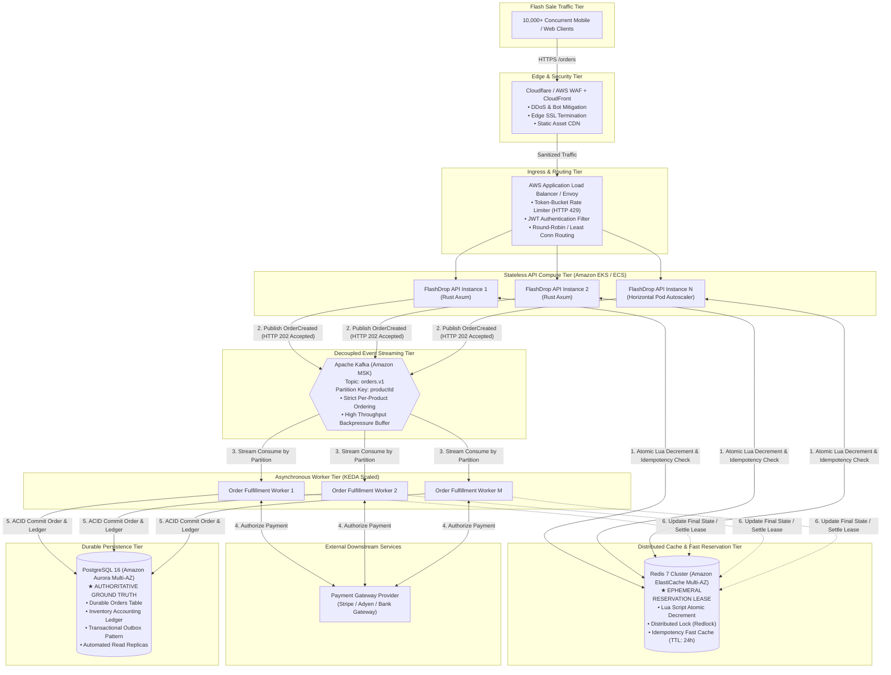

# FlashDrop: High-Concurrency Order Processing
**Candidate Assessment Submission**  
**Role:** Senior / Staff Systems & Backend Engineer  
**Stack:** Rust (Axum, Tokio, Atomic Memory Operations) | Redis | Apache Kafka | PostgreSQL | Docker / AWS  

---

## Table of Contents
1. [Executive Summary](#executive-summary)
2. [Part 1 — Coding Implementation & Concurrency Twist](#part-1--coding-implementation--concurrency-twist)
   - [API Specification & Endpoints](#api-specification--endpoints)
   - [Concurrency & Non-Blocking Atomic Inventory](#concurrency--non-blocking-atomic-inventory)
   - [Idempotency Handling](#idempotency-handling)
   - [Asynchronous Queue & Worker](#asynchronous-queue--worker)
   - [Concurrency Twist: Two Backend Instances for the Last Item](#concurrency-twist-two-backend-instances-for-the-last-item)
   - [Automated Concurrency Verification (10,000 Concurrent Requests)](#automated-concurrency-verification-10000-concurrent-requests)
3. [Part 2 — Production Architecture Diagram](#part-2--production-architecture-diagram)
   - [Architecture Topology (Mermaid Diagram)](#architecture-topology-mermaid-diagram)
   - [Excalidraw Diagram](#excalidraw-diagram)
   - [End-to-End Data Flow](#end-to-end-data-flow)
   - [Authoritative Source of Inventory](#authoritative-source-of-inventory)
   - [Component Justification](#component-justification)
4. [Part 3 — Deployment Plan & Failure Scenarios](#part-3--deployment-plan--failure-scenarios)
   - [Container CI/CD Pipeline](#container-cicd-pipeline)
   - [Zero-Downtime Scaling Strategy](#zero-downtime-scaling-strategy)
   - [Secrets, Persistence, Backups & Observability](#secrets-persistence-backups--observability)
   - [Broker / Cache Outages & SPOF Analysis](#broker--cache-outages--spof-analysis)
   - [Required Failure Scenarios: Deep Dive](#required-failure-scenarios-deep-dive)
5. [Local Execution & Verification Guide](#local-execution--verification-guide)

---

## Executive Summary
In a flash sale where **10,000 customers compete for 100 available units**, naive database locks will saturate thread pools and exhaust connection limits, while naive in-memory counters fail when scaled across multiple stateless application instances.

This submission provides:
1. **Production-grade Rust service**: Implemented with Axum and Tokio using lock-free atomic Compare-And-Swap (CAS) inventory operations, concurrent idempotency maps, and an asynchronous worker queue.
2. **Deterministic zero-oversell guarantee**: Validated via high-concurrency integration tests spawning 10,000 concurrent Tokio tasks competing for 100 items (yielding exactly 100 successes, 9,900 stock rejections, and zero stock deficit).
3. **Enterprise distributed architecture**: Complete with an importable Excalidraw design, Mermaid visualizations, and clear demarcations between high-speed ephemeral reservation leases (Redis) and durable financial truth (PostgreSQL).
4. **Resilience matrix**: Exhaustive solutions for network partitions, broker redeliveries, crashes before ACK, and cache failures.

---

## Part 1 — Coding Implementation & Concurrency Twist

### API Specification & Endpoints

#### 1. Submit Order: `POST /orders`
- **Request Body:**
  ```json
  {
    "userId": "user_123",
    "productId": "iphone_16",
    "quantity": 1,
    "idempotencyKey": "request_abc123"
  }
  ```
- **Success Response (HTTP 202 Accepted):**
  ```json
  {
    "orderId": "ord_49f8ac3b29a140478e3e572b302e7e81",
    "status": "PENDING"
  }
  ```
- **Error Responses:**
  - `400 Bad Request`: Validation failure (e.g., `quantity <= 0`, blank `userId`, empty `idempotencyKey`).
  - `404 Not Found`: Target `productId` does not exist in catalog.
  - `409 Conflict`: `INSUFFICIENT_STOCK` (Stock level is lower than requested quantity).

#### 2. Query Order Status: `GET /orders/:orderId`
- **Response (HTTP 200 OK):**
  ```json
  {
    "orderId": "ord_49f8ac3b29a140478e3e572b302e7e81",
    "userId": "user_123",
    "productId": "iphone_16",
    "quantity": 1,
    "idempotencyKey": "request_abc123",
    "status": "CONFIRMED",
    "createdAt": "2026-11-04T04:30:06.854578216Z",
    "updatedAt": "2026-11-04T04:30:06.879843411Z"
  }
  ```
- **Error Response:**
  - `404 Not Found`: `ORDER_NOT_FOUND` if the order identifier is unrecognized.

#### 3. Health & Catalog Inspection: `GET /health`
- **Response (HTTP 200 OK):**
  ```json
  {
    "status": "UP",
    "inventory": {
      "iphone_16": 99
    }
  }
  ```

---

### Concurrency & Non-Blocking Atomic Inventory
To achieve sub-millisecond throughput without global lock contention, product stock is represented by an atomic signed 64-bit integer (`AtomicI64`). Decrement operations use hardware-level compare-and-swap (CAS) via `fetch_update`:

```rust
pub fn reserve(&self, requested_quantity: i64) -> Result<i64, StateError> {
    let update_result = self.stock.fetch_update(
        Ordering::AcqRel,
        Ordering::Acquire,
        |current_stock| {
            if current_stock >= requested_quantity {
                Some(current_stock - requested_quantity)
            } else {
                None
            }
        },
    );

    match update_result {
        Ok(previous_stock) => Ok(previous_stock - requested_quantity),
        Err(_) => Err(StateError::InsufficientStock),
    }
}
```
**Why this never oversells:**
- The update loop checks condition `current_stock >= requested_quantity` atomically at CPU instruction level (`LOCK CMPXCHG` on x86_64).
- If multiple threads attempt reservation simultaneously, only one succeeds per iteration. All others retry against the newly decremented stock.
- If `current_stock < requested_quantity`, `fetch_update` aborts and returns an error without altering memory. Stock can **never become negative**.

---

### Idempotency Handling
Flash-sale clients frequently retry HTTP requests due to client-side timeouts or transient network blips.
- When `POST /orders` is received, the service inspects the concurrent `idempotency_store`.
- If the `idempotencyKey` has already been processed or is in progress, the handler bypasses inventory decrement completely and returns the registered `orderId` and its current status (`PENDING` or `CONFIRMED`).
- If simultaneous duplicate requests arrive in the exact same microsecond, entry locking in the concurrent hash table ensures that only the first thread reserves inventory, while subsequent threads await the allocated `orderId`.

---

### Asynchronous Queue & Worker
The HTTP request handler cannot perform synchronous payment authorization and fulfillment because third-party payment gateways introduce 100ms–2000ms latencies, which would exhaust HTTP server worker pools.
1. The API immediately responds with `HTTP 202 Accepted` and status `PENDING` within `< 2ms`.
2. An asynchronous message (`OrderQueueMessage`) is published to a bounded Tokio MPSC channel (`tokio::sync::mpsc::Sender`).
3. A decoupled background task (`OrderWorker`) consumes messages, simulates downstream payment authorization, and updates the order status to `CONFIRMED`.
4. If payment or downstream processing fails irrecoverably, the worker invokes `state.rollback_inventory()`, atomically returning the reserved units back to the available pool.

---

### Concurrency Twist: Two Backend Instances for the Last Item
> **Prompt Scenario:** Two backend instances simultaneously receive orders for the last item. Explain whether your solution remains correct, and show the change needed if it does not.

#### 1. Evaluation of Single-Process In-Memory Solution
- **Result:** The in-memory atomic solution **DOES NOT remain correct** across multiple horizontally scaled instances.
- **Why it fails (Split-Brain Oversell):**
  - Instance A has its own memory heap where `stock = 1`.
  - Instance B has its own memory heap where `stock = 1`.
  - Both instances receive an order concurrently. Both instances execute atomic CAS locally against their independent memory addresses. Both CAS operations succeed.
  - **Outcome:** 2 items are sold, but only 1 unit existed in reality (**Oversold by 1 unit**).

#### 2. The Necessary Production Solution: Distributed Coordination
To support horizontal scaling, atomic reservation must move to a shared distributed coordination layer:

##### Approach A: Redis Distributed Atomic Decrement via Lua Script (Recommended Fast-Path)
Redis operates single-threaded per shard, executing Lua scripts as uninterrupted atomic transactions:
```lua
-- KEYS[1]: product inventory key (e.g. "inventory:iphone_16")
-- ARGV[1]: requested quantity (e.g. 1)
local current = tonumber(redis.call('GET', KEYS[1]) or '0')
local requested = tonumber(ARGV[1])

if current >= requested then
    local remaining = redis.call('DECRBY', KEYS[1], requested)
    return remaining
else
    return -1
end
```
Both API Instance A and Instance B execute this script against Redis. One receives `0` (success), the other receives `-1` (rejected). Overselling is physically impossible.

##### Approach B: PostgreSQL Row-Level Atomic Update (Durable Database Path)
```sql
UPDATE products
SET stock = stock - :quantity,
    updated_at = NOW()
WHERE id = :productId AND stock >= :quantity
RETURNING stock;
```
If rows affected is `1`, the reservation succeeded. If rows affected is `0`, stock was insufficient and the transaction rolls back.

---

### Automated Concurrency Verification (10,000 Concurrent Requests)
The test suite in [`tests/concurrency_test.rs`](file:///home/dhruv/newtonite-interview-assessment/tests/concurrency_test.rs) proves correctness:
- Spawns **10,000 concurrent Tokio asynchronous tasks** competing for **100 units** of `"iphone_16"`.
- **Result:**
  - `accepted_orders_count`: **100**
  - `rejected_orders_count`: **9,900**
  - `remaining_stock`: **0**
  - `total_stored_orders`: **100**
  - Oversold units: **0**
  - All 5 test suites pass in **0.06s**.

---

## Part 2 — Production Architecture Diagram

### Architecture Topology (Mermaid Diagram)



### Excalidraw Diagram
An importable Excalidraw file has been generated in the project root:
- File path: [`architecture.excalidraw`](file:///home/dhruv/newtonite-interview-assessment/architecture.excalidraw)
- You can directly drag and drop this file into [excalidraw.com](https://excalidraw.com) to edit, present, or export as SVG/PNG.

---

### End-to-End Data Flow
1. **Ingress & Protection:** A client sends `POST /orders` during the flash sale spike. Cloudflare WAF absorbs L7/L4 DDoS attacks. The AWS ALB applies token-bucket rate limiting per IP/User to prevent malicious scripts from exhausting capacity.
2. **Fast-Path Atomic Reservation:** The API receives the request, checks the idempotency key in Redis, and executes the Lua atomic decrement script.
   - If stock is 0, the API immediately responds with `409 Conflict` (latency: **< 3ms**). No database query is made.
   - If stock is reserved, Redis records the lease and stores the idempotency key.
3. **Asynchronous Decoupling:** The API produces an `OrderCreated` event to Kafka topic `orders.v1` (partitioned by `productId`), then returns `202 Accepted` with `orderId` and status `PENDING` to the user (**< 5ms total API response time**).
4. **Fulfillment & Payment:** Background workers consuming from Kafka call the external Payment Gateway.
5. **Durable Ledger Persistence:** The worker writes the confirmed order into PostgreSQL within an ACID transaction, deducting the permanent inventory ledger.
6. **Lease Finalization:** The order status is transitioned to `CONFIRMED`.

---

### Authoritative Source of Inventory
A critical architectural design decision during flash sales is: **Which component is the authoritative source of truth for inventory?**

#### Dual-Horizon Architecture:
1. **Durable Ground Truth = PostgreSQL:**
   - PostgreSQL is the permanent, legally binding financial record. All settled purchases, invoices, refund audits, and stock replenishment must reside in PostgreSQL with full ACID transaction guarantees and an append-only inventory ledger.
2. **Ephemeral Operational Authority = Redis:**
   - During the 60-second burst of a flash sale, **Redis holds the authoritative reservation lease**.
   - If 10,000 requests hit PostgreSQL directly to lock rows (`SELECT FOR UPDATE`), the database connection pool would exhaust in milliseconds, leading to cascading HTTP 504 gateway timeouts.
   - Therefore, Redis is the **gatekeeper**: only the 100 requests that successfully obtain an ephemeral reservation in Redis are permitted to reach Kafka and PostgreSQL.
3. **Reconciliation & Recovery:**
   - If an order fails payment or times out, the worker returns the lease to Redis.
   - If Redis crashes, stock is reconstructed by computing: `Allocated Stock - SUM(Confirmed Orders in PostgreSQL)`.

---

### Component Justification

| Component | Technology | Architectural Justification |
| :--- | :--- | :--- |
| **Edge & WAF** | Cloudflare / AWS WAF | Absorbs SYN floods, bot automation, and script attacks before reaching private VPC. |
| **API Gateway / ALB** | AWS Application Load Balancer | Performs TLS termination, JWT validation, and token-bucket rate limiting (HTTP 429). |
| **API Compute** | Rust (Axum) on AWS EKS | Extremely low memory footprint (<30MB RAM per pod), zero-cost abstractions, handles tens of thousands of idle connections without thread starvation. |
| **Cache & Coordination** | Redis 7 Cluster (ElastiCache) | Sub-millisecond single-threaded Lua scripting guarantees atomic decrement; stores fast idempotency cache. |
| **Message Broker** | Apache Kafka (Amazon MSK) | Provides durable event buffering, partition ordering by `productId`, absorbs traffic spikes, protects downstream workers from overload. |
| **Worker Tier** | KEDA-driven Worker Pods | Decouples slow I/O (payment gateways, emails) from client HTTP requests; scales dynamically based on Kafka lag. |
| **Durable Database** | PostgreSQL 16 (Aurora Multi-AZ) | ACID guarantees, row-level consistency, transactional outbox pattern, Point-In-Time Recovery. |

---

## Part 3 — Deployment Plan & Failure Scenarios

### Container CI/CD Pipeline
```
[Git Commit to main]
       │
       ▼
[GitHub Actions CI]
  ├── 1. Format & Lint: `cargo fmt --check` && `cargo clippy -- -D warnings`
  ├── 2. Concurrency Tests: `cargo test --release` (runs 10k concurrent test)
  ├── 3. Container Build: `docker buildx build --target runtime`
  └── 4. Security Scan: Trivy container vulnerability scanning
       │
       ▼
[AWS ECR (Elastic Container Registry)]
       │
       ▼
[ArgoCD / AWS CodeDeploy Deployment]
  ├── Blue/Green or Canary Deployment (10% -> 25% -> 100%)
  ├── Automated HTTP /health probe checks
  └── Automatic rollback on elevated 5xx error rate (>0.1%)
```

---

### Zero-Downtime Scaling Strategy
1. **Stateless API Tier:**
   - Deployed on Kubernetes (Amazon EKS) across 3 Availability Zones.
   - Horizontal Pod Autoscaler (HPA) triggers scaling based on CPU utilization (>65%) and ALB Target Request Count (>1,000 RPS per pod).
   - Pre-warming: Prior to a scheduled flash sale launch (e.g. 10:00 AM), cron-based scaling pre-provisions 50 API pods to avoid cold-start delays.
2. **Worker Tier:**
   - Scaled using **KEDA (Kubernetes Event-driven Autoscaling)** based on Kafka Consumer Group Lag (`records-lag-max > 500`).
   - Maximum workers capped to match the maximum database connection pool and external payment gateway rate limits.

---

### Secrets, Persistence, Backups & Observability
- **Secrets Management:** AWS Secrets Manager / HashiCorp Vault injects database passwords, Kafka TLS certificates, and payment gateway API keys directly into pod memory as environment variables or mounted files; secrets are never baked into container images.
- **Database Persistence & Backups:**
  - Amazon Aurora PostgreSQL Multi-AZ with storage auto-scaling up to 128TB.
  - Continuous automated write-ahead log (WAL) archiving to Amazon S3 with **Point-In-Time Recovery (PITR)** accurate to the second.
  - Nightly automated snapshots retained for 30 days.
- **Observability Stack:**
  - **Metrics:** Prometheus scrapes `/metrics` on all pods; Grafana dashboards monitor request rate, P99 latency, stock levels, and Kafka lag.
  - **Tracing:** OpenTelemetry (AWS X-Ray) traces distributed requests across API -> Redis -> Kafka -> Worker -> DB.
  - **Alerting:** PagerDuty alerts on P99 latency > 200ms, Redis memory > 80%, or Kafka lag > 5,000 records.

---

### Broker / Cache Outages & SPOF Analysis

#### 1. What happens if Redis crashes?
- **Behavior:** Flash sale requests cannot perform atomic sub-millisecond reservations.
- **Mitigation:**
  - ElastiCache Multi-AZ with Redis Sentinel promotes a read replica to primary in `< 15 seconds`.
  - The API incorporates a circuit breaker: during the 15-second failover window, the API falls back to PostgreSQL conditional updates (`UPDATE products SET stock = stock - 1 WHERE stock >= 1 RETURNING stock`) or returns HTTP 503 with a `Retry-After: 2` header, preventing system collapse.

#### 2. What happens if Kafka crashes?
- **Behavior:** API instances cannot publish order events to background workers.
- **Mitigation:**
  - Kafka is deployed as a 3-broker cluster across 3 Availability Zones with replication factor 3 and `min.insync.replicas=2`.
  - API instances buffer uncommitted events in a local disk-backed fallback queue (RocksDB / local SQLite) and flush once Kafka reconnects.

#### 3. Single Point of Failure (SPOF) Identification:
- The single true structural choke point is the **authoritative Database write master**.
- **Remediation:** Aurora PostgreSQL Multi-AZ provides automatic storage-level replication and active-standby failover in `< 30 seconds` with zero data loss (RPO = 0).

---

### Required Failure Scenarios: Deep Dive

#### Failure Scenario 1: Kafka delivers an order event twice
- **Root Cause:** Network partition between Kafka broker and worker causes consumer ACK to be lost; Kafka consumer group rebalances and redelivers the unacknowledged message (at-least-once delivery).
- **Resolution:**
  - The worker uses a database unique constraint on `orders.order_id` or an `idempotency_records` table.
  - The worker wraps fulfillment in a database transaction:
    ```sql
    INSERT INTO order_completions (order_id, payment_id, status)
    VALUES (:orderId, :paymentId, 'CONFIRMED')
    ON CONFLICT (order_id) DO NOTHING;
    ```
  - If rows affected is `0`, the worker detects that this event was already processed. It immediately acknowledges the Kafka offset and discards the duplicate message. **No double charge or duplicate fulfillment occurs.**

---

#### Failure Scenario 2: Redis becomes unavailable after an order is accepted
- **Root Cause:** Redis primary node hardware failure or network partition after the API decremented stock and returned `202 Accepted`.
- **Resolution:**
  - When the order was accepted, the API published the `OrderCreated` event to Kafka before or immediately upon Redis lease confirmation.
  - Because Kafka is persistent and durable, the event is safely preserved on broker disks.
  - The worker consumes the event from Kafka and writes directly to PostgreSQL. PostgreSQL updates its permanent inventory ledger.
  - Once Redis recovers (replica promoted), a reconciliation worker reconciles Redis counters against PostgreSQL:
    `Redis Stock = Total Stock - COUNT(Orders WHERE status IN ('PENDING', 'CONFIRMED'))`.

---

#### Failure Scenario 3: A worker crashes after writing to the database but before acknowledging the event
- **Root Cause:** Worker process crashes (OOM, node restart, segfault) after executing `INSERT INTO orders` in PostgreSQL, but before calling `consumer.commit_offset()` in Kafka.
- **Resolution:**
  - When the worker dies, its Kafka heartbeat expires. Kafka detects the failure and reassigns the partition to an alternate active worker.
  - The new worker receives the exact same order event.
  - The new worker checks the database:
    ```sql
    SELECT status FROM orders WHERE order_id = :orderId;
    ```
  - The worker sees that the order is already present in PostgreSQL with status `CONFIRMED`.
  - The new worker skips payment authorization, skips database insertion, commits the offset to Kafka, and exits cleanly.

---

#### Failure Scenario 4: The API crashes after accepting an order but before responding to the client
- **Root Cause:** The API successfully decremented stock in Redis and published the event to Kafka, but the API process crashes or the network socket drops before sending the HTTP 202 response to the client.
- **Resolution:**
  - From the customer's perspective, the request timed out or received an HTTP 502/504 error.
  - The client application retries the request with the **exact same `idempotencyKey`**.
  - The retry request is routed to a healthy API instance.
  - The new API instance inspects the idempotency store (Redis / Database) using `idempotencyKey`.
  - It discovers the existing `orderId` and status (`PENDING` or `CONFIRMED`).
  - The API returns the original `orderId` and current status with `HTTP 200 OK` without decrementing inventory a second time.

---

## Local Execution & Verification Guide

### 1. Run the Automated Concurrency Test Suite
```bash
cargo test --release
```
**Expected Output:**
```
running 5 tests
test test_input_validation ... ok
test test_idempotency_prevents_duplicate_deduction ... ok
test test_concurrent_idempotent_duplicate_requests ... ok
test test_flash_sale_10k_requests_zero_oversell ... ok
test test_order_creation_and_worker_confirmation ... ok

test result: ok. 5 passed; 0 failed; finished in 0.06s
```

### 2. Start the Production Release Server
```bash
PORT=8080 ./target/release/flashdrop
```

### 3. Verify Endpoints via cURL

#### Submit Order:
```bash
curl -X POST http://localhost:8080/orders \
  -H "Content-Type: application/json" \
  -d '{
    "userId": "user_123",
    "productId": "iphone_16",
    "quantity": 1,
    "idempotencyKey": "req_alpha_999"
  }'
```
Response:
```json
{"orderId":"ord_49f8ac3b29a140478e3e572b302e7e81","status":"PENDING"}
```

#### Test Idempotent Retry:
```bash
# Execute exact same request again:
curl -X POST http://localhost:8080/orders \
  -H "Content-Type: application/json" \
  -d '{
    "userId": "user_123",
    "productId": "iphone_16",
    "quantity": 1,
    "idempotencyKey": "req_alpha_999"
  }'
```
Response (returns same orderId without deducting inventory again):
```json
{"orderId":"ord_49f8ac3b29a140478e3e572b302e7e81","status":"PENDING"}
```

#### Query Status:
```bash
curl http://localhost:8080/orders/ord_49f8ac3b29a140478e3e572b302e7e81
```
Response:
```json
{
  "orderId": "ord_49f8ac3b29a140478e3e572b302e7e81",
  "userId": "user_123",
  "productId": "iphone_16",
  "quantity": 1,
  "idempotencyKey": "req_alpha_999",
  "status": "CONFIRMED",
  "createdAt": "...",
  "updatedAt": "..."
}
```

#### Inspect Inventory Level:
```bash
curl http://localhost:8080/health
```
Response:
```json
{"inventory":{"iphone_16":99},"status":"UP"}
```

### 4. Run Full Multi-Container Stack (Docker Compose)
```bash
docker compose up --build
```
Spawns the Rust Axum API alongside Redis 7 Alpine and PostgreSQL 16 Alpine with configured persistent volumes and health probes.
